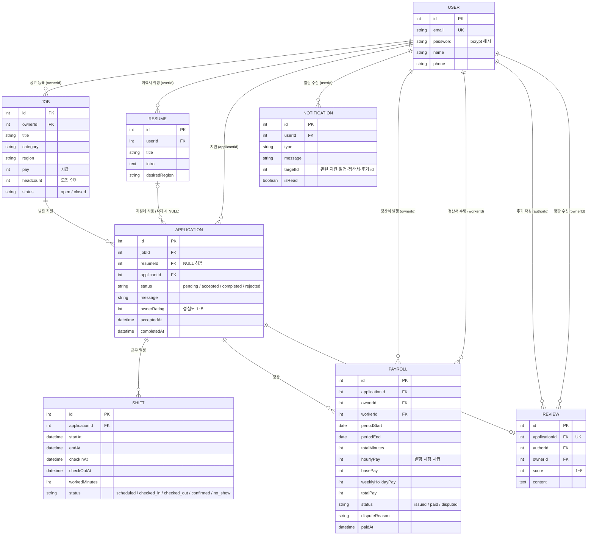

# ERD (엔티티 관계도)

> 기준: `models/*.js`. 서버를 켠 뒤 `http://localhost:3000/erd.html` 에서도 같은 그림을 볼 수 있습니다.
> 표기: `||` 정확히 1 · `o|` 0 또는 1 · `o{` 0개 이상(N) · PK 기본키 · FK 외래키 · UK 유일

## 읽는 법
- **User** 가 중심입니다. 사장님·알바생 구분 없이 한 종류이고, 하는 행동(공고 등록 / 지원)으로 역할이 정해집니다.
- **Application(지원)** 이 두 번째 중심입니다. 공고(Job)와 이력서(Resume)를 이어 주는 N:M 연결 역할을 하면서 자체 상태·평점을 가지며, Shift / Payroll / Review 가 모두 여기에 매달립니다.
- **1:1** 은 `Application — Review` 하나뿐입니다 (`applicationId` UNIQUE).
- **Payroll / Review** 는 User 를 두 번 가리킵니다 (발행자·수령자 / 작성자·평판 대상).
- 제약: `UNIQUE(jobId, applicantId)` — 같은 공고에 같은 사람은 한 번만 지원 (거절 후 재지원도 불가).
- 삭제 규칙: 공고 삭제 시 지원 CASCADE, 이력서 삭제 시 지원의 `resumeId` 만 NULL (완료된 지원의 경력은 유지).
