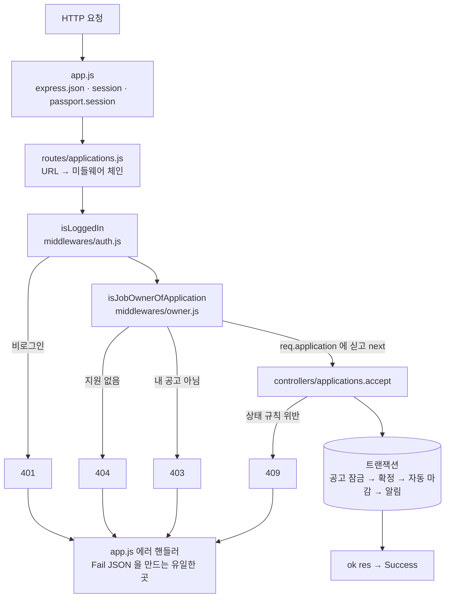

# 요청 한 건의 여정 — `PATCH /applications/:id/accept`

45개 API 는 모두 같은 패턴입니다. 가장 규칙이 많은 **채용 확정** 하나를 끝까지 따라가면 나머지는 그 반복입니다.

```
요청 PATCH /applications/7/accept   (사장님 로그인 상태)
```

## 전체 지도



## 단계별 설명

### ① `app.js` — 모든 요청이 먼저 지나는 곳
- `express.json()` 이 body 를 읽고, `express-session` + `passport.session()` 이 **세션 쿠키로 로그인한 사용자를 `req.user` 에 채웁니다** (`passport/index.js` 의 `deserializeUser`).
- 이 시점에는 아직 아무것도 검사하지 않습니다.

### ② `routes/applications.js` — 길 안내
```js
router.patch('/:id/accept', isLoggedIn, isJobOwnerOfApplication, c.accept);
```
이 한 줄이 이 API 의 전부를 설명합니다. **왼쪽에서 오른쪽으로 차례대로** 통과해야 하고, 중간에 에러가 나면 뒤는 실행되지 않습니다.

### ③ `isLoggedIn` — "로그인했나?" → 아니면 **401**
`req.isAuthenticated()` 만 봅니다.

### ④ `isJobOwnerOfApplication` — "이 일을 할 수 있는 사람인가?"
1. `:id` 가 올바른 숫자인지 → 아니면 **400**
2. 지원을 DB 에서 찾는다 (Job 포함) → 없으면 **404**
3. 지원한 공고의 `ownerId` 가 `req.user.id` 와 같은지 → 아니면 **403**
4. 찾은 지원을 `req.application` 에 싣고 `next()` — **컨트롤러는 다시 조회하지 않아도 됩니다**

> "누가 할 수 있나"는 여기서 끝납니다. 컨트롤러는 사람을 의심하지 않고 **상태만** 봅니다.

### ⑤ `controllers/applications.accept` — "지금 해도 되는 상태인가?"
하나의 **트랜잭션**(`sequelize.transaction`) 안에서 순서대로:

| 순서 | 하는 일 | 실패하면 |
|---|---|---|
| 1 | 공고 행을 **잠근다** (`lock: t.LOCK.UPDATE`) — 같은 공고에 확정을 동시에 눌러도 한 명씩 순서대로 | — |
| 2 | 지원을 다시 읽는다 (잠금 이후의 최신 상태) | — |
| 3 | `pending` 이 아니거나 공고가 `closed` 인가? | **409** |
| 4 | 확정 인원(accepted + completed)이 이미 모집인원 이상인가? | **409** 정원 초과 |
| 5 | 지원을 `accepted` 로, `acceptedAt` 기록 | — |
| 6 | 확정 인원 + 1 ≥ 모집인원이면 **공고를 `closed`** | — |
| 7 | 알바생에게 `application_accepted` 알림 생성 | — |

- 어느 단계든 에러가 나면 **롤백**됩니다 (확정은 됐는데 알림이 없는 상태가 생기지 않음).
- 1번 잠금이 없다면: 정원 1명인 공고에 두 지원을 동시에 확정할 때 둘 다 4번을 통과해 **2명이 확정**될 수 있습니다.

### ⑥ 응답
성공: `ok(res, { application, job: { id, status, headcount, confirmedCount } })`
```json
{ "result": "Success", "data": { "application": { "status": "accepted", … }, "job": { "status": "closed", "confirmedCount": 1 } } }
```
실패: 어디서든 `throw new HttpError(409, '…')` → `catch (err) { next(err); }` → **`app.js` 의 에러 핸들러**가 `{ "result": "Fail", "error": "…" }` 로 변환합니다. (Fail 형식을 만드는 곳은 한 군데뿐)

---

## 이 패턴이 45개 전부에 똑같이 적용됩니다

| 단계 | 파일 | 책임 | 나오는 상태 코드 |
|---|---|---|---|
| 1 | `app.js` | 세션 → `req.user` | — |
| 2 | `routes/*.js` | URL → 체인 연결 | — |
| 3 | `middlewares/auth.js` | 로그인 여부 | **401** (가입·로그인 API 는 이미 로그인이면 400) |
| 4 | `middlewares/owner.js` | 대상 찾기 + 주인 검사 | **404 / 403** (id 형식 오류 400) |
| 5 | `controllers/*.js` | 입력 검증 → 상태 규칙 → DB | **400 / 404 / 409** |
| 6 | `utils/response.js` + `app.js` | 응답 형식 | Success / Fail |

### 상태 코드를 보면 어느 층의 문제인지 바로 압니다
| 코드 | 의미 | 어디서 |
|---|---|---|
| 400 | 값이 잘못됨 | 컨트롤러 입력 검증 (`utils/validate.js`) |
| 401 | 로그인 안 함 | `isLoggedIn` |
| 403 | 로그인했지만 내 것이 아님 | `owner.js` 미들웨어, 또는 컨트롤러의 본인 확인 |
| 404 | 대상 없음 | `owner.js` 미들웨어, 또는 컨트롤러 |
| 409 | 지금 상태에서는 할 수 없음 | 컨트롤러 (상태 규칙), 또는 DB UNIQUE 위반 |

### 다른 API 에서 바뀌는 것은 두 가지뿐
1. **어떤 미들웨어를 쓰는가** — 공고 주인 / 이력서 주인 / 일정의 알바생 / 정산서 발행자 / 알림 주인 … (`owner.js` 에 11개)
2. **컨트롤러의 상태 규칙** — 어느 상태에서 어느 상태로 갈 수 있는가 (→ [state-flow.md](state-flow.md))

## 다른 유형도 같은 틀입니다

| 유형 | 예 | 특징 |
|---|---|---|
| 조회 | `GET /jobs` | 미들웨어 없음 (공개), 필터·페이지네이션 |
| 생성 | `POST /jobs` | `ownerId` 를 **클라이언트가 아니라 `req.user.id` 로** 서버가 채움 |
| 상태 변경 | `PATCH /shifts/:id/check-in` | 위와 동일: 미들웨어(주인) → 컨트롤러(상태·시간 규칙) |
| 계산 | `POST /payrolls` | 급여를 클라이언트가 아니라 **서버가** 확인된 근무로 계산 (`utils/payroll.js`) |
| 파생 조회 | `GET /resumes/:id/careers` | 저장하지 않고 조회할 때마다 완료된 지원에서 **계산** |

## 콘솔로 직접 확인하기
`http://localhost:3000` → **▶ 시나리오** 탭의 "권한·상태 규칙 시연" 에서
- 제3자가 남의 지원을 확정 → **403** (④ 에서 막힘)
- 이미 확정된 지원을 다시 확정 → **409** (⑤ 에서 막힘)
- 로그인 없이 지원 → **401** (③ 에서 막힘)

을 누르면 같은 요청이 **어느 층에서 막히는지**를 상태 코드로 확인할 수 있습니다.
