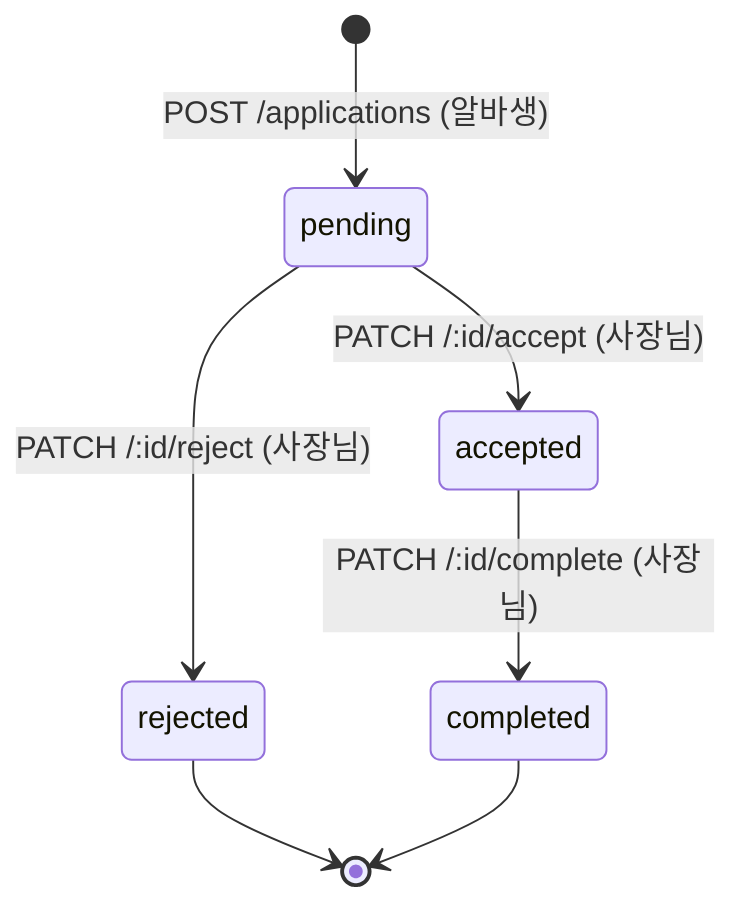
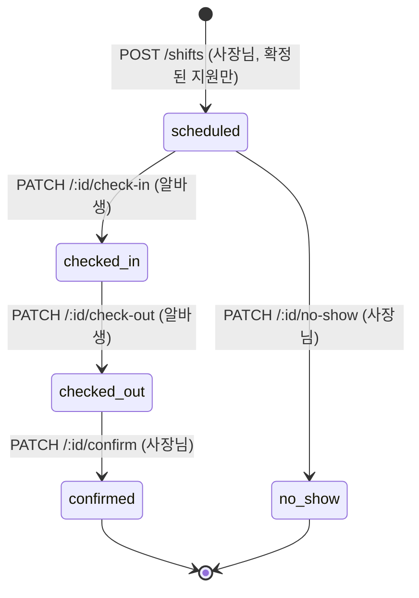
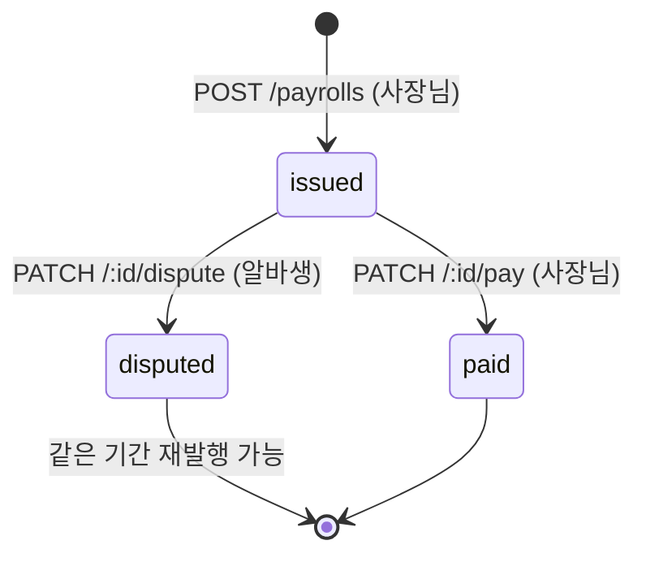
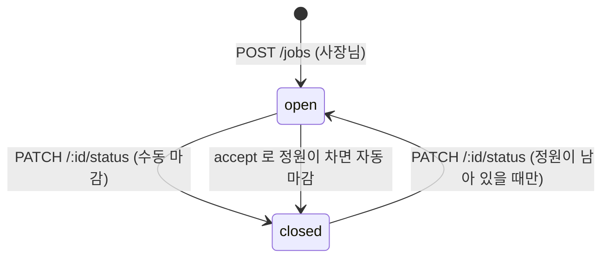
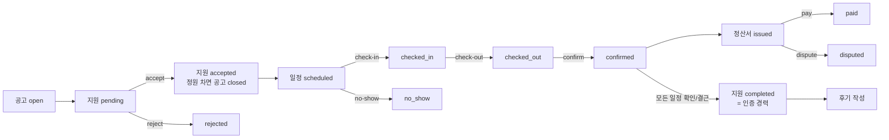

# 상태 흐름도 — API는 "상태를 한 칸 옮기는 버튼"이다

이 프로젝트의 API 45개 중 대부분은 **어떤 데이터의 `status` 를 다음 상태로 옮기는 일**입니다.
외울 것은 API 목록이 아니라 아래 4개의 상태 흐름과 "누가 · 어느 상태에서만" 입니다.

- **누가** → 미들웨어가 검사 (아니면 401 / 403 / 404)
- **어느 상태에서** → 컨트롤러가 검사 (아니면 **409**)

> 409 는 "화살표가 없는 길로 가려고 했다"는 뜻입니다.

---

## 1. 지원 (Application)

| 전이 | 누가 | 409 가 나는 조건 |
|---|---|---|
| (없음) → pending | 알바생 (본인 이력서로) | 마감된 공고, 이미 지원한 공고 (거절당해도 재지원 불가) |
| pending → accepted | 공고 작성자 | 대기 상태가 아님 · 공고가 마감됨 · **정원이 가득 참** |
| pending → rejected | 공고 작성자 | 대기 상태가 아님 |
| accepted → completed | 공고 작성자 | 확정 상태가 아님 · 아직 확인/결근 처리 안 된 일정이 있음 · **확인된 근무가 1건도 없음** |

- `accept` 로 확정 인원이 모집인원에 도달하면 **공고가 자동으로 `closed`** 됩니다.
- `complete` 는 성실도 평점(1~5)을 받고, 완료된 지원이 곧 **인증 경력**(`GET /resumes/:id/careers`)이 됩니다.
- 완료된 지원에만 **후기**(`POST /reviews`)를 쓸 수 있습니다 (지원 1건당 1개).

## 2. 근무 일정 (Shift)

| 전이 | 누가 | 409 / 규칙 |
|---|---|---|
| 일정 등록 | 사장님 | 지원이 `accepted` 가 아님 · 같은 알바생의 다른 일정과 **시간이 겹침** |
| scheduled → checked_in | 그 일정의 알바생 | 예정 시작 시간 **±30분 밖** |
| checked_in → checked_out | 그 일정의 알바생 | 출근 상태가 아님. `workedMinutes` = 퇴근 − 출근 |
| checked_out → confirmed | 공고 작성자 | 퇴근 상태가 아님 |
| scheduled → no_show | 공고 작성자 | 예정 상태가 아님 · **시작 시간 전** |

- **`confirmed` 가 된 근무만** 급여와 경력에 반영됩니다. 사장님의 확인이 "인증"의 근거입니다.

## 3. 정산서 (Payroll)

| 전이 | 누가 | 409 / 규칙 |
|---|---|---|
| 발행 | 사장님 | 기간 안에 **확인된 근무 없음** · 겹치는 기간에 이미 정산서가 있음 (이의제기 상태는 제외) |
| issued → paid | 발행한 사장님 | 발행 상태가 아님 |
| issued → disputed | 받는 알바생 | 발행 상태가 아님 · 사유(reason) 없으면 400 |

- 급여는 서버가 계산합니다: **기본급 = 확인된 근무 분 × 시급 ÷ 60**, **주휴수당 = 그 주 확인 근무 15시간 이상 & 결근 없음일 때 근무분 × 시급 ÷ 300**.
- 발행 시점의 시급을 저장하므로, 나중에 공고 시급이 바뀌어도 발행된 금액은 그대로입니다.

## 4. 공고 (Job)

- 재오픈은 확정 인원 < 모집인원일 때만 가능합니다 (아니면 409).
- 모집인원을 확정 인원보다 적게 수정하면 409, 확정·완료 지원이 있는 공고 삭제도 409.

---

## 5. 한눈에 보는 전체 흐름

## 6. 각 단계에서 자동으로 만들어지는 알림

알림은 API 로 만들 수 없고, 아래 상태 변경 때 **같은 트랜잭션 안에서** 서버가 만듭니다.

| 일어난 일 | 알림 종류 | 받는 사람 |
|---|---|---|
| 지원 | application_received | 사장님 |
| 확정 / 거절 / 완료 | application_accepted / rejected / completed | 알바생 |
| 일정 등록 | shift_created | 알바생 |
| 정산서 발행 | payroll_issued | 알바생 |
| 이의제기 | payroll_disputed | 사장님 |
| 후기 작성 | review_created | 사장님 |

(출근·퇴근·확인·결근·지급 완료는 알림을 만들지 않습니다.)

## 7. 역할별로 보면

| 사장님 (공고 작성자) | 알바생 (지원자) |
|---|---|
| 공고 등록·수정·삭제·마감 | 이력서 작성·수정·삭제 |
| 지원 확정·거절·완료 | 공고에 지원 |
| 근무 일정 등록 | **출근·퇴근 체크** |
| 근무 확인·결근 처리 | 정산서 확인·**이의제기** |
| 정산서 발행·지급 완료 | **후기 작성** |

회원에 "사장님/알바생" 구분은 없습니다. **그 공고의 주인이면 사장님, 그 지원의 지원자면 알바생**이 되고, 이 판단을 `middlewares/owner.js` 가 합니다.
